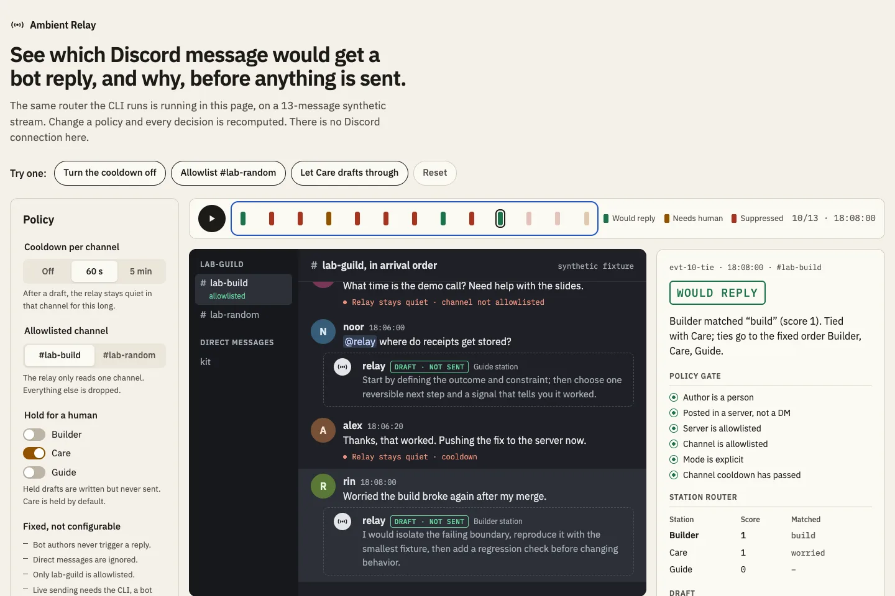
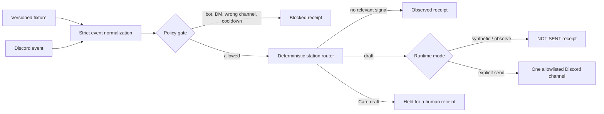

# Ambient Relay

**Live demo: [ambient-relay.vercel.app](https://ambient-relay.vercel.app)**

[](https://ambient-relay.vercel.app)

Ambient Relay is a local Discord automation lab for proving the dangerous part first: **which event would trigger which reply, under which policy, without sending anything**.

It replays a versioned synthetic Discord event stream through a deterministic router. Every event ends in one of three outcomes: a drafted reply, a draft held for a human, or no reply, each with a body-free receipt that says why. Nothing is sent unless you go out of your way to start the gated live adapter.

There are two ways to run it:

- **Browser lab** (the demo above). The real router from `src/core` is bundled into a static page. Scrub through the 13 events, change the cooldown, the allowlisted channel or which stations need human review, and every decision is recomputed in place. Changed decisions are flagged against the default policy.
- **CLI.** `npm start` prints the same replay as a terminal proof. It needs no install, token, account, network connection, AI provider or `.env` file.

```text
┌─ EVENT evt-01-deploy
│ policy   allowed.route-evaluation
│ route    station.builder
│ receipt  relay_613d0d4c02446db4  /  drafted
│ event    5bda28d3881c…4dc00458
│ outbound NOT SENT  /  dry-run.synthetic-default
└───────────────────────────────────────────────────────────────────────────
```

The complete checked-in terminal proof is [artifacts/demo-session.txt](artifacts/demo-session.txt). CI regenerates it in memory and fails if it drifts from the executable replay. The browser lab produces the same receipt IDs as the CLI for the default policy.

## What is real

| Boundary | Status | Network | Sends messages |
| --- | --- | --- | --- |
| Synthetic event replay (CLI and browser lab) | Implemented and tested | No | No |
| Event validation, bot/DM/allowlist/cooldown policy | Implemented and tested | No | No |
| Deterministic Builder, Care, and Guide stations | Implemented and tested | No AI involved | No by default |
| Human-review hold (Care by default) | Implemented and tested | No | Never, in any mode |
| Metadata-only receipts | Implemented and tested | No | No |
| Discord observe adapter | Implemented, **not tested with a live Discord account** | Yes | No |
| Discord send adapter | Implemented, **not tested with a live Discord account** | Yes | Only after exact acknowledgement and one-channel allowlist |
| LLM or OpenRouter responses | Not implemented | — | — |
| Redis, long-term memory, cost prediction, operator dashboards | Not implemented | — | — |

The station replies are fixed local templates. “Deterministic” does not mean intelligent, and a receipt proves what this process decided—not that Discord accepted or preserved an action.

## Run it locally

Requires Node.js 22.13 or newer.

```bash
npm start                 # terminal proof, Node standard library only
npm run demo:json         # machine-readable decisions and receipts
```

The browser lab needs the dev dependencies (Vite, TypeScript and a pure-JS SHA-256):

```bash
npm ci --ignore-scripts
npm run web:dev           # http://localhost:4181
npm run web:build         # static site in dist/
```

The core hashes with `node:crypto`. In the browser build, Vite aliases that one import to [web/src/node-crypto.js](web/src/node-crypto.js), and a test checks it against Node's SHA-256. Nothing else in `src/core` is changed or stubbed for the browser.

## Tests

```bash
npm test                  # node:test suite, no credentials
npm run check             # syntax, tests, artifact drift, secret scan, web build
```

## How routing works



Technical terms route to Builder, emotional language routes to Care, and questions or direct mentions route to Guide. Keywords match whole words with an optional plural or verb ending, so "test" matches "testing" but not "latest". Ties use a fixed station order. User content is used in memory for routing and hashing but is never interpolated into a reply.

Care is a fixed acknowledgement template, not a mental-health, moderation, or crisis-response system. Its drafts are held for human review by default (`needs-human` receipts, which in live mode carry a link to the Discord message) and are never delivered, even in send mode. Do not use the experimental live adapter as a substitute for trained human support or an established escalation path.

## Live boundary

Live mode is deliberately inconvenient. It is not part of the verified demo.

1. Install the optional dependency with `npm ci --ignore-scripts`.
2. In the Discord Developer Portal, enable the privileged **Message Content** intent for the bot.
3. Give the bot only the permissions required for the chosen channel: View Channel, Read Message History, and—only for send mode—Send Messages.
4. Provide runtime values through your shell or secret manager. [.env.example](.env.example) is blank/comment-only and the application never loads it automatically.
5. Set `AMBIENT_RELAY_MODE` to `discord-observe` or `discord-send`, and set exact guild and channel IDs. Observe mode connects and receives content but never sends.
6. Send mode additionally requires `AMBIENT_RELAY_SEND_ACK` to equal `I_ACCEPT_ONE_CHANNEL_SENDS` exactly.
7. Start with `npm run live`.

The adapter ignores all non-allowlisted guilds/channels before routing, ignores bots and DMs at policy, suppresses every allowed-mention expansion, and logs reduced receipts rather than message or reply bodies. It has no remote deployment story and should be run from a controlled local machine only.

## Limits of the demo

- The stream is 13 hand-written synthetic events. The browser lab cannot load your own server's messages and has no Discord client.
- The stations are keyword matchers with fixed reply templates. They don't understand the message.
- Only the cooldown, the allowlisted channel and human-review stations can be changed in the lab. Bot, DM and guild checks are fixed on purpose.
- The live adapter has unit tests at its pure boundaries but has not been run against a real Discord account.

## Project map

- `src/core/` — pure normalization, policy, routing, hashing, receipts and fixture replay
- `web/` — the browser lab (Vite, vanilla TypeScript), deployed to Vercel
- `src/fixtures/` — public synthetic Discord-shaped events
- `src/live/discord-adapter.js` — isolated, dynamically imported Discord boundary
- `src/presentation/terminal.js` — deterministic proof renderer
- `test/` — credential-free Node test suite
- [ARCHITECTURE.md](ARCHITECTURE.md) — invariants and data flow
- [SECURITY.md](SECURITY.md) — baseline findings, mitigations, and residual risk
- [RUNBOOK.md](RUNBOOK.md) — safe operation and incident steps

Licensed under the [MIT License](LICENSE).
