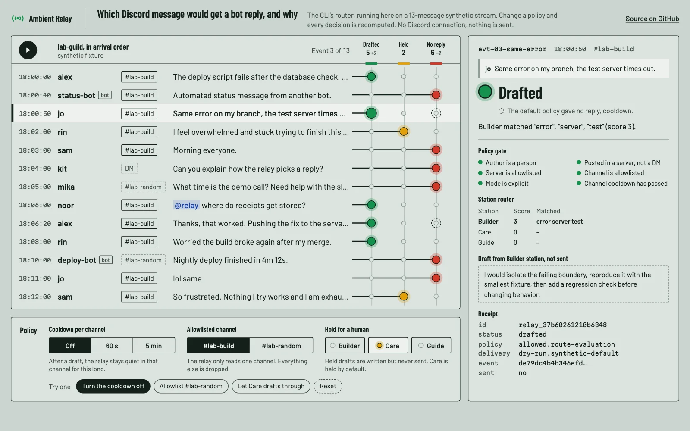

# Ambient Relay

Ambient Relay shows which Discord message a bot would reply to and why, before anything is sent. It replays 13 synthetic Discord events through a deterministic router, and each one ends as a drafted reply, a draft held for a human or no reply, with a receipt that records the decision but not the message text.

[](https://ambient-relay.vercel.app)

## Try it

Open [ambient-relay.vercel.app](https://ambient-relay.vercel.app). The page runs the real router from `src/core` in your browser. Pick an event to see its decision, or change the cooldown, the allowlisted channel or which stations need human review, and every decision is recomputed. A dashed ring marks where the default policy would have sent any event that changed. There is no Discord connection on the page.

## Run it locally

You need Node.js 22.13 or newer. The terminal replay uses only the standard library, so it runs without an install or a Discord token.

```bash
npm start            # terminal replay
npm run demo:json    # the same decisions as JSON
```

The browser lab and the checks need the dev dependencies.

```bash
npm ci --ignore-scripts
npm run web:dev      # http://localhost:4181
npm run check        # syntax, tests, artifact drift, secret scan, web build
```

## How it decides

A policy gate drops bot authors, direct messages, anything outside the one allowlisted guild and channel, and anything inside the per-channel cooldown. Events that pass go to three keyword stations. Builder picks up technical terms, Care emotional language and Guide questions and direct mentions, with ties broken in that order. The replies are fixed templates and never quote the user's message. Care drafts are held for a human by default and are never delivered, in any mode.

Care is an acknowledgement template. It is not a moderation or crisis-support system.

## What's real

The router and its receipts are covered by `npm test`. The checked-in terminal proof, [artifacts/demo-session.txt](artifacts/demo-session.txt), is regenerated in CI, which fails if it drifts from the replay. For the default policy the browser lab produces the same receipt IDs as the CLI.

The stream is 13 hand-written events, and the stations match keywords without understanding the message. There is no LLM. Bot, DM and guild rules are fixed in the lab on purpose.

A live Discord adapter exists in `src/live/discord-adapter.js` but has only been unit tested, never run against a real Discord account. It stays off unless you set `AMBIENT_RELAY_MODE` to `discord-observe` (reads only) or `discord-send`, plus exact guild and channel IDs. Send mode also needs `AMBIENT_RELAY_SEND_ACK=I_ACCEPT_ONE_CHANNEL_SENDS` and replies in that one channel only. [RUNBOOK.md](RUNBOOK.md) has the setup, [SECURITY.md](SECURITY.md) the known risks and [ARCHITECTURE.md](ARCHITECTURE.md) the invariants.

Licensed under the [MIT Licence](LICENSE).
